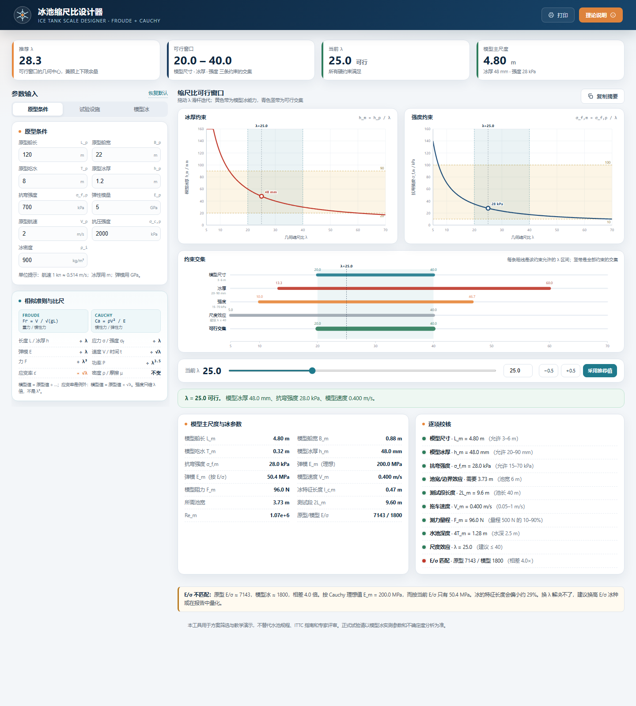

# 冰池缩尺比设计器 · Ice Tank Scale Designer

一个**单文件、零依赖**的交互式网页，用于冰水池船模破冰试验的缩尺比 λ 初步筛选：把 **Froude + Cauchy 相似准则**与**水池能力**、**模型冰能力**放在一起，实时给出可行窗口、推荐 λ、模型冰目标参数和逐项校核。

**在线使用：** <https://pilotphil.github.io/Ice-Tank-Scale-Designer/>



---

## 功能

- **参数输入**（三个标签页）
  - 原型条件：船长、船宽、吃水、冰厚、抗弯强度、弹模、航速等；
  - 试验设施：水池长宽深、最大/最小模型长、拖车速度、水密度、原型阻力、测力计量程；
  - 模型冰：盐水冰、尿素冰、EG/AD/S、气泡盐冰、FGX、非冻结合成冰预设，可手动改冰厚/强度/E·σ 范围。
- **可行窗口**
  - 两条曲线：`h_m = h_p/λ`、`σ_f,m = σ_f,p/λ`；
  - 黄色带 = 模型冰能力，青色竖带 = 三条硬约束的交集；
  - “约束交集”阶梯图：一眼看出模型尺寸、冰厚、强度、尺度效应哪条在卡 λ。
- **迭代**
  - λ 滑杆 / 数字输入 / ±0.5 / “采用推荐值”（可行窗口几何中心）；
  - 实时更新 KPI、曲线、结论条、模型参数表、逐项校核和提示。
- **校核**
  - 模型尺寸、冰厚、强度、池宽/特征长度、测试段、拖车速度、力量程、水深、尺度效应、E/σ 匹配。
- **理论说明**
  - 右上角按钮打开：相似比尺表、Froude/Cauchy/Reynolds、模型冰限制、可行窗口公式、两条定 λ 路径、实际案例、常见误区、参考文献。
- **导出**
  - 复制设计摘要；打印时自动隐藏输入区，输出两页 A4。

---

## 原理（简版）

定义 `λ = L_p / L_m`。Froude 与 Cauchy 同时成立时：

```text
h_m   = h_p / λ
σ_m   = σ_p / λ
E_m   = E_p / λ
V_m   = V_p / √λ
F_m   = F_p / λ³
ε̇_m   = √λ · ε̇_p
```

三条硬约束给出 λ 区间：

```text
λ_min = max( L_p/L_m,max,  h_p/h_m,max,  σ_p/σ_m,max )
λ_max = min( L_p/L_m,min,  h_p/h_m,min,  σ_p/σ_m,min )
可行条件：λ_min ≤ λ ≤ λ_max
```

再叠加尺度效应建议上限（默认 λ ≤ 40），推荐值取可行窗口的几何中心：

```text
λ_rec = √( λ_min × min(λ_max, 40) )
```

最后做点校核：冰的特征长度 `l_c` 与池宽、测试段 `2L_m`、拖车速度、模型力量程、水深 `4T_m`、E/σ 匹配等。

**关键点：** E/σ 是模型冰的材料属性，λ 改变不了它。工具会把“理想 E”和“按 E/σ 的 E”并列显示，并提示 E 偏低、`l_c` 偏小；正确做法是换冰种、改工艺或在报告中量化，而不是硬调 λ。

---

## 本地运行

直接双击 `index.html` 即可；不需要构建、服务器或任何外部库。

如果要用本地服务器：

```bash
python -m http.server 8000
# 打开 http://localhost:8000/
```

---

## 适用范围与免责声明

- 默认经验范围：模型冰厚 **20–90 mm**、抗弯强度 **10–100 kPa**、尺度效应上限 **λ ≤ 40**；都可以在“模型冰”里改。
- 适合**平整冰、弯曲主导**的船模破冰/冰阻力试验的方案筛选；碎冰、冰脊、挤压主导的试验可把模型冰范围改窄，或把它当第一轮筛选。
- 本工具用于方案筛选与教学演示，**不替代** ITTC 指南、FSICR 附录 4、水池规程和专家评审。正式试验请以模型冰实测参数和不确定度分析为准。

---

## 主要参考文献

- ITTC. *General Guidance and Introduction to Ice Model Testing*, 7.5-02-04-01, Rev. 03, 2021.
- ITTC. *Test Methods for Model Ice Properties*, 7.5-02-04-02, Rev. 03, 2021.
- Wang, J., Lau, M. *A state-of-the-art review on ice modeling methodologies employed in refrigerated ice tanks*. NRC LM-2007-05, 2007.
- Izadi, M. *Model Ice: Physical mechanisms of formation and mechanical properties*. Aalto University Doctoral Theses 139/2026.
- Matala, R., Suominen, M. *Investigation of vessel resistance in model scale brash ice channels and comparison to full scale tests*. Cold Regions Science and Technology, 2022.
- 李志军, 王永学, 李广伟. DUT-1 合成模型冰的弯曲强度和弹性模量实验分析. 水科学进展, 2002.
- 田于逵, 季少鹏, 王迎晖, 等. CSSRC 小型冰水池中海冰模拟与测试研究. 海洋环境科学, 2021.
- 张雨晴, 何炎平, 陈哲, 等. 碎冰模型形状对船舶碎冰阻力数值预报的影响. 舰船科学技术, 2024.
